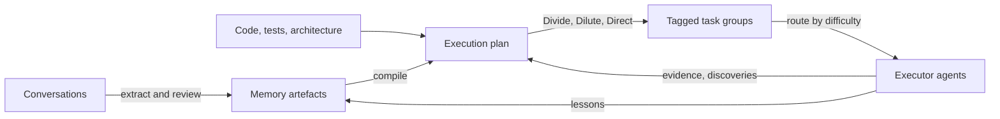
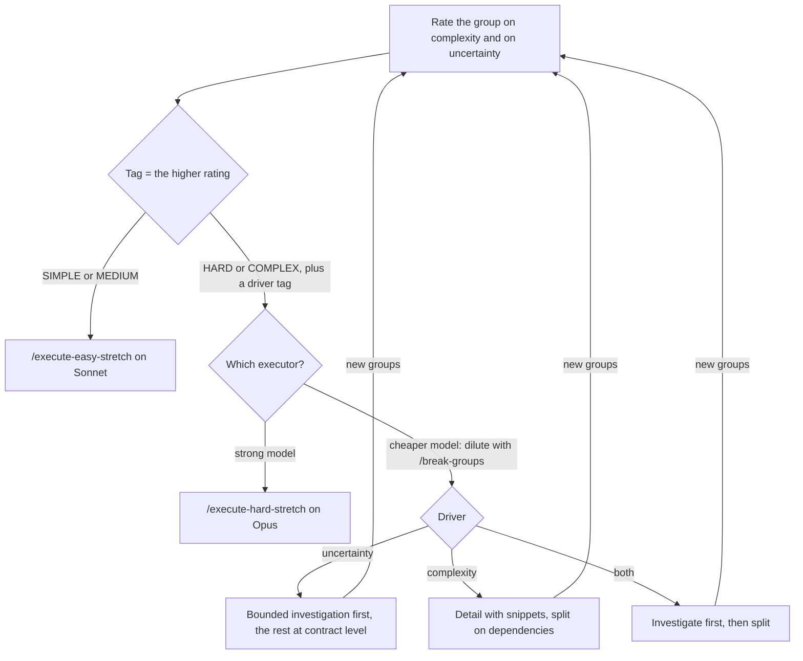

# Context-Compiled Development (CCD)

**Divide, Dilute, Direct**

CCD is a methodology for planning, executing and maintaining software work done by LLM agents. Engineering intent, live project knowledge and artefacts extracted from conversations are compiled into **execution plans**: Markdown documents whose tasks are grouped, sized and tagged so that each group can be routed to the cheapest capable model and executed with only the context it needs.

The compiler analogy is deliberate. A compiler lowers something written for a mind, pass by pass, into something a simpler machine can run, without changing what it means. CCD lowers *difficulty* in the same way and must preserve *intent*: requirements, invariants and acceptance criteria survive every pass unchanged.

## The pipeline

### Divide

- Tasks are numbered hierarchically (`1.1`, `1.2`, `2.1`…), ordered by dependency, and grouped by implementation difficulty rather than by topic.
- A group holds **at most 8 tasks**. Eight is a ceiling, not a target.
- The plan is divided into **areas** at context transitions (a change of layer, ownership boundary or source of truth). Each area opens with its own **Area Mandatory Reading** block, so an agent loads only the contracts that govern the work in front of it.

### Dilute

Dilution passes lower the difficulty of groups that are too hard for the intended executor. `/break-groups` runs them:

1. `/break-groups complex`: `{{COMPLEX}}` → `{{HARD}}` or lower, plus any `{{HARD}}` group that turns out to be `{{COMPLEX}}`.
2. `/break-groups hard`: `{{HARD}}`, and any `{{COMPLEX}}` left, → `{{MEDIUM}}` or lower. A group that can't be split further without becoming artificial stays `{{HARD}}`, with the reason noted.

Each pass treats a group according to what made it hard, its **driver** (see [Difficulty tags](#difficulty-tags)):

- **Uncertainty.** Detailed steps for an unverified approach would only make a guess look authoritative. The pass first adds a bounded investigation or prototype task, in its own earlier group, with a limit and a stated output. Then it details only the work the answer can't change, and keeps the rest at contract level.
- **Complexity.** The approach is known but laborious. The pass inspects the live code, adds detail (code snippets, Mermaid diagrams, exact contracts), and splits along dependency and verification boundaries.
- **Both.** The uncertainty is resolved first, then the complex part is split.

Every snippet is labelled **Observed** (existing code, verified now), **Required contract** (an interface or invariant the work must preserve) or **Illustrative** (one possible approach, to check before using it). Work expected from earlier groups is marked:

> `ASSUMPTION: this was already built previously. If not, re-assess at runtime.`

After every pass, each new group is rated again on both drivers and grouping is re-run. Dilution thins the difficulty, never the intent: splitting a task must not drop an acceptance criterion or invariant, and no Verification line may get weaker. A pass has to make the work more executable, not merely longer; lowering a tag by adding prose doesn't count.

### Direct

- Every group carries one difficulty tag, on its own line directly above its tasks. A `{{HARD}}` or `{{COMPLEX}}` tag is followed, on the same line, by a **driver tag** naming what made it hard: `{{HARD}} {{driver: uncertainty}}`.
- The tags are routing metadata: a router or decision model can dispatch the group without reading its tasks. `/execute-easy-stretch` runs `{{SIMPLE}}` and `{{MEDIUM}}` groups on Sonnet, `/execute-hard-stretch` runs `{{HARD}}` and `{{COMPLEX}}` groups on Opus, and each stops where the tier changes.
- Every group tells its executor **where to look** (mandatory reading), **when to stop** (prerequisite gates) and **what counts as done** (its **Outcome** and **Verification** lines).

## Difficulty tags

Each group is rated as a whole, not task by task, on two drivers:

- **Complexity:** the reasoning the work needs once the approach is known: how many contracts, components or files must stay consistent, and how intricate the logic is.
- **Uncertainty:** what is still unknown: an approach not yet chosen, unverified behaviour of a library, API or legacy code, or unsettled requirements.

| Tag | Complexity at this level | Uncertainty at this level |
| --- | --- | --- |
| `{{SIMPLE}}` | A local, well-understood change. | None: no open design decisions. |
| `{{MEDIUM}}` | An established pattern across a bounded area, with clear contracts and checks. | Small: the answers are in the code or docs at hand. |
| `{{HARD}}` | Several contracts to coordinate, or substantial debugging. | The approach, or some behaviour, must be investigated within a settled design. |
| `{{COMPLEX}}` | Many interacting contracts or a large context, with judgment calls throughout. | Unresolved architectural, algorithmic or exploratory decisions. |

The tag is the **higher** of the two ratings, so either driver alone can make a group `{{HARD}}` or `{{COMPLEX}}`. Such a group names its driver, or both, in a second tag: `{{driver: complexity}}`, `{{driver: uncertainty}}` or `{{driver: complexity + uncertainty}}`. `{{SIMPLE}}` and `{{MEDIUM}}` groups carry no driver tag.

Difficulty describes the reasoning left for the executor, not the consequences of getting it wrong. High-risk work keeps strong verification even after it has been diluted. A group where a mistake would be costly whatever its difficulty (security, data loss, a public contract) gets a risk line above its tags: `Risk: HIGH — <the extra review or checks required>`.

## Plan anatomy

| Section | Position | Role |
| --- | --- | --- |
| **Global Mandatory Reading** | Directly after the title | Thin set of contracts every executor needs, plus the verbatim execution protocol. Columns: `File name \| Line Ranges \| Description`. |
| **Objective Contract** | After Global Mandatory Reading | The fixed objective, acceptance criteria, protected contracts and execution permissions. The groups below it are a strategy that executors may revise. |
| **Open Questions** | After the Objective Contract | Every question only the user can answer, each with a recommended answer. Executors ask the open ones together, before they start. |
| **Area Mandatory Reading** | Before the first group it governs | Area-specific contracts, with coverage stated as `_Applies to Groups 6-10._`. May contain an **entry gate** for prerequisites that might not exist yet. |
| **Task groups** | Body | Outcome and Verification lines, the difficulty tag (plus a driver tag on `{{HARD}}` and `{{COMPLEX}}`), then up to 8 `[ ]` tasks, each with a stable ID such as `T-r2bla5-014`. |
| **Consult on Demand** | After the last group | Sources read only when a concrete trigger occurs. Columns: `Trigger \| File name \| Start at \| Expand only when \| Consultation purpose`. |
| **Planning Provenance** | After Consult on Demand | What shaped the plan. Never an execution reading queue and never preloaded. |
| **Completion Conditions** | Last; only Review sections may follow | Plan-level acceptance and the final regression command. Required. |

### Context rules

- **Symbols over line numbers.** Named headings and exported symbols are authoritative. Line ranges are navigation hints; when they drift, relocate the symbol instead of reading the whole file.
- **Non-transitive reading.** A referenced document's own reading lists are never inherited.
- **Live over historical.** For delivered behaviour, live public code and executable tests outrank architecture prose and predecessor plans.
- **Triggered consultation.** A Consult on Demand source is read only after its trigger fires. It never silently becomes mandatory.
- **Hard prerequisite gates.** An entry gate names the contract that must exist, how to verify it, which tasks stop if it is absent, what independent work may continue, and which fallback paths must not be used to bypass it.

## Execution protocol

- Execute groups top to bottom. Mark a task `[X]` only when its acceptance checks pass; "implemented but unverified" stays unchecked, with the reason recorded.
- Read Global Mandatory Reading before the first task and the nearest preceding Area block before each group. After every context compaction, re-read only the parts relevant to the active group.
- After each compaction, note it above the active group: `Context has compacted X times while executing this group.`
- More than 3 compactions on one group means the group is too big: split it in place into `B`, `C`, `D` sub-groups, each with its own Area Mandatory Reading.
- Run tests in focused bursts for the active group. Run broader regressions at shared-contract boundaries and at the end of the plan, not continuously.
- Plans are living documents. Revise them as implementation reveals new facts, but never weaken acceptance criteria to get a green result.

## Memory artefacts

The decisions, patterns and prompts that make an AI-assisted project work are mostly buried in conversations. CCD extracts them into **artefacts** that are:

- **sourced**: they record the conversation or change they came from;
- **reviewed**: they are approved before they can influence plans or defaults;
- **supersedable**: they are marked stale instead of lingering.

Artefacts are intermediate material. They are compiled back into plans, default agent prompts and architecture documentation. The review step matters because unreviewed agent memory amplifies context pollution: an assumption saved once is retrieved indefinitely.

## File conventions

- Plans are Markdown files with a plan prefix (for example `r2bla5-`). Auxiliary files live next to the plan and extend its prefix with a letter, in chronological order: `r2bla5-a-…`, `r2bla5-b-…`.
- No source, test or JSON file may start with a plan prefix. No Markdown files are created in source directories unless explicitly requested.
- Source file headers link to the relevant architecture document (`archi*.md`), plan (`r*.md`), or both.

## Skills

The method ships as Claude Code skills in [`.claude/skills/`](.claude/skills/). You run each one by typing `/<name>`; the model never starts one on its own. Each skill sets its own model, so the routing by difficulty happens when you invoke it. A typical run:

1. `/planning-template` writes the plan.
2. `/break-groups complex`, then `/break-groups hard`, dilute it for cheaper executors.
3. `/execute-easy-stretch` and `/execute-hard-stretch` take turns through the plan. Alternatively, `/execute-plan` runs all of it on the current model.
4. `/review-implementation` reviews the result. `/plan-review-fixes` turns the findings into tasks, and `/execute-plan <plan> post-review` implements them.
5. `/commit-all-repos` commits the work.

### Planning

| Skill | Model | What it does |
| --- | --- | --- |
| `/planning-template [what to plan]` | Opus, high | Writes a plan in the full format: dependency-ordered groups of at most 8 tasks, rated on both drivers and tagged; Global and Area Mandatory Reading; Objective Contract; Open Questions; Consult on Demand; Planning Provenance; Completion Conditions. It saves the plan next to the project's other plans, runs the plan validator ([`scripts/validate_plan.py`](.claude/skills/planning-template/scripts/validate_plan.py)), and asks the open questions in one message. |
| `/break-groups <complex\|hard> [plan]` | Opus, high | Runs one dilution pass: `complex` lowers `{{COMPLEX}}` groups to `{{HARD}}` or below, and `hard` lowers `{{HARD}}` groups to `{{MEDIUM}}` or below. Each group is handled by its driver, then re-rated and regrouped, and the validator runs at the end. |
| `/plan-repo-merge <other-location> <merge-plan>` | Opus, high | Plans a merge of a parallel copy of the repos into this one, in the full plan format. It compares plans and code, detects plan-prefix collisions, and includes safety branches, lockfile regeneration and a final build-and-test phase. |
| `/document-architecture [output] ["scope"]` | Opus, high | Writes descriptive architecture documentation (`archi-*.md`): nine fixed sections with stable headings that source-file headers can link to, file:line evidence, an "as of" revision, and Mermaid diagrams. |
| `/review-architecture [output] ["scope"]` | Opus, high | A judging architecture review: strengths to keep, risks and failure modes, coupling and ownership problems, and recommendations ranked by impact, each with its evidence. |

### Execution

All three execute skills share the same rules:
- ask every open question up front;
- mark a task `[X]` only once it is verified, with an Evidence note per group;
- change the plan only within an authority table, recording each decision;
- keep one checkpoint file per plan;
- follow the commenting standard;
- run tests in proportion to what a change could break;
- follow the file-placement table;
- never commit.

| Skill | Model | What it does |
| --- | --- | --- |
| `/execute-plan [plan] [post-review]` | current model | Executes every group, top to bottom. With `post-review`, only the tasks added after the latest review. |
| `/execute-easy-stretch [plan]` | Sonnet, medium | Runs `{{SIMPLE}}` and `{{MEDIUM}}` groups until the first `{{HARD}}` or `{{COMPLEX}}` one, then reports where it stopped. |
| `/execute-hard-stretch [plan]` | Opus, high | Runs `{{HARD}}` and `{{COMPLEX}}` groups until the first `{{SIMPLE}}` or `{{MEDIUM}}` one, then reports where it stopped. |
| `/stop-with-handover` | current model | Stops after the current task: marks the verified work and updates the plan's checkpoint file, so the next session can pick up (for example after an IDE refresh). |

### Review

| Skill | Model | What it does |
| --- | --- | --- |
| `/review-implementation <plan> [since-ref]` | Opus, high, in a separate context | An adversarial review of what the plan produced. It re-runs the evidence, looks for counterexamples and weakened assertions, and checks contracts, comments and file placement. Then it appends a numbered `## Review N` with findings R1, R2… to the plan. |
| `/plan-review-fixes [plan]` | Opus, high | Turns the latest review's findings into post-review task groups, with their own Area Mandatory Reading, broken down for the executor. |

### Operations

| Skill | Model | What it does |
| --- | --- | --- |
| `/count-plan-tasks <plan>` | Haiku | Counts open, done, blocked and superseded tasks per group without the model reading the plan (the numbers are precomputed), and names the next group. |
| `/commit-all-repos` | Sonnet, low | Commits every repo in the workspace, with a message naming the plans and groups completed. It lists files that look wrong to commit and asks first, and it never pushes. |
| `/split-fresh-plan [plan]` | Sonnet, high | Splits an oversized plan that hasn't started yet into self-contained parts of about 60 KiB, with the next plan prefixes. |
| `/split-executing-plan [plan]` | Opus, high | Moves a running plan's unfinished work into a new plan with the next prefix, carrying over its history, decisions and checkpoint, and closes the old plan. |
| `/comment-modified-files` | Sonnet, medium | Brings changed code in every repo up to the commenting standard: the file header plus the code the change touched, and nothing else. |
